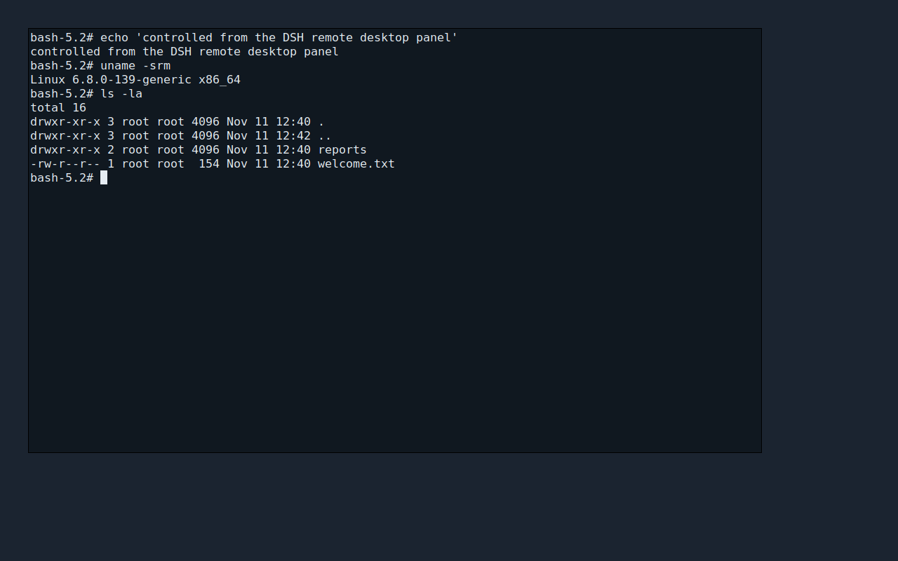

# DSH 远程桌面（Remote Desktop）

在 DeepSeek Harness 的 Web UI 里加一个**远程桌面窗口**：左侧边栏入口 → 主面板里连接另一台主机，实时看它的屏幕、用鼠标键盘操作它、传文件、开远程命令行。

参考了 [1Remote](https://github.com/1Remote/1Remote)（多协议远程会话管理器的产品结构）以及向日葵 / 网易 UU 远程这类软件的核心体验（一侧被控 Agent + 一侧控制端，低延迟画面 + 输入回传 + 文件/终端辅助面板）。区别在于：本项目把控制端直接做进 Harness Web UI，被控端是一个**零 npm 依赖的单文件 Node.js Agent**，不经过第三方服务器。

```
┌──────────────────────────────┐         ┌────────────────────────────────────┐
│ Harness Web UI（浏览器）      │         │ 被控主机                            │
│                              │  WS     │  remote-agent.mjs                  │
│ 侧边栏「远程桌面」            │────────▶│   ├─ X11 屏幕采集（纯 JS 实现）      │
│  ├─ 主机列表 / 连接           │  HTTP   │   ├─ XTEST 鼠标键盘注入              │
│  ├─ 远程画面 canvas           │────────▶│   ├─ 文件 API（fs-root 沙箱）        │
│  ├─ 文件传输抽屉              │         │   └─ 远程 shell（PTY）              │
│  └─ 命令终端抽屉              │         │        │                            │
└──────────────────────────────┘         │        ▼ X11 协议                   │
                                         │   Xorg / Xvfb（桌面会话）           │
                                         └────────────────────────────────────┘
```

## 功能

**已实现（v1，真实可用）**

- 侧边栏入口 + 主面板页面：`@local/remote-desktop` 插件（纯前端，无需 Host 服务）。
- 主机管理：名称 / 地址 / 密码，保存在浏览器 localStorage，可增删改。
- 实时屏幕：被控端纯 JS X11 `GetImage` 采集，瓦片级脏区检测，zlib 压缩增量帧，浏览器 `DecompressionStream` 解码后画到 canvas；自动适配容器缩放（信箱式），显示远端光标位置与按键状态。
- 鼠标键盘控制：移动 / 左中右键 / 滚轮 / 键盘（含修饰键、方向键、F1-F12、小键盘、CapsLock 等），键盘捕获模式（点击画面捕获，工具栏或画面外点击释放，失焦自动 `releaseAll` 防卡键）。
- 文件传输：远程目录浏览、下载、上传（多文件）、新建目录、重命名、删除；路径限制在 Agent 的 `--fs-root` 内。
- 远程命令行：持久 shell 会话（`script` 分配 PTY），流式输出 + 最小 VT 处理（CR/LF/退格/清屏/剥色），键盘输入 + 单行命令输入框。
- 连接管理：密码鉴权（token）、断线自动重连（指数退避）、状态/错误提示、心跳。
- 零依赖 Agent：只用 Node 内置模块 + 系统 X11 socket、`script`、可选 `xdotool`；不需要在被控机装 VNC/RDP 或任何 npm 包。
- 无 X 环境的降级：屏幕/输入不可用时仍可只用文件与命令行。

**后续可做（本文档不承诺）**：H.264/WebRTC 低延迟编码、Windows/macOS 采集后端、TLS/wss、剪贴板双向同步、多标签页、SSH 隧道/中继、音频、录屏。

## 目录

```
/opt/remote
├── agent/                 被控端 Agent（零依赖，拷贝到被控机即可）
│   ├── remote-agent.mjs   CLI 入口 / HTTP + WS 会话编排
│   └── lib/               x11 / capture / input / ws / http / files / shell
├── plugin/                Harness Web UI 插件 @local/remote-desktop
│   ├── client.js          侧边栏入口 + 主面板（画面/文件/终端全部 UI）
│   ├── index.js           空 Host 半（bundle 需要一个 Host 行）
│   ├── package.json       dsh.bundle / dsh.client 声明
│   └── cordis.patch.yml   Loader patch
├── test/                  Xvfb 真实端到端测试（屏幕/鼠标/键盘/文件/命令）
├── demo/                  真实远程画面演示（截图）
└── docs/                  协议契约 / X11 实现笔记 / 插件实现规范
```

## 快速开始

### 1. 被控主机上启动 Agent

要求：Linux + X11 桌面（Xorg/Xvfb 均可）+ Node.js ≥ 18。把 `agent/` 目录拷到被控机：

```bash
# 在被控机
node agent/remote-agent.mjs \
  --port 38080 \
  --password '换成一个强密码' \
  --display :0 \
  --fs-root /home/you
```

看到 `remote-agent listening on http://0.0.0.0:38080 ...` 即成功；放行 TCP 38080（或只在内网/SSH 隧道里使用，见「安全」）。

> 纯命令行场景（不需要图形桌面）可以加 `--no-screen`，仍然能传文件、跑命令。
> 只想临时测试可加 `--insecure`（无密码，且未显式 --bind 时只监听 127.0.0.1）。

### 2. Harness 里启用插件

插件包位于 `/opt/remote/plugin`，本机已安装到当前 `web` profile（`@local/remote-desktop`，bundle 已启用）。

- 如果侧边栏还没出现「远程桌面」图标：刷新页面（Ctrl/Cmd+R）。新装的客户端插件通常会被 Harness 的 client HMR 热加载；刷新一定可以拿到最新版本。
- 换一台 Harness 部署时重新安装：
  ```
  plugin_manager action=install_bundle target=/opt/remote/plugin
  ```
  安装会写入当前 profile 的 bundle 列表并在 `application: applied` 后生效；卸载用 `plugin_manager action=remove_bundle target=@local/remote-desktop`。

### 3. 连接

1. 点击侧边栏「远程桌面」；
2. 「＋ 添加主机」→ 名称随便填，地址填 `被控机IP`（默认端口 38080）或 `被控机IP:端口`，密码填 Agent 的 `--password`；
3. 点击主机 → 连接 → 画面出现后点击画面即可捕获键盘，鼠标/滚轮直接操作远端；
4. 工具栏「文件」打开文件抽屉，「终端」打开命令行抽屉。

### 在本机快速试用（可选）

仓库自带一个只监听 loopback 的演示被控端（Xvfb :97 + xterm + bash，文件沙箱 `demo/sandbox/`）：

```bash
bash scripts/demo-serve.sh     # 输出: host 127.0.0.1:38080 / password demo-pass
bash scripts/demo-stop.sh      # 停止
```

面板里「添加主机」→ 地址 `127.0.0.1:38080`、密码 `demo-pass` 即可连接。注意它只绑定 `127.0.0.1`：只有浏览器与 Harness 在同一台机器时才连得上；真实远程主机请在被控机按上文启动 Agent（可配合 `ssh -L 38080:127.0.0.1:38080 user@host` 做隧道）。



## 验证

本仓库的验证全部基于真实 X 服务器与真实 Agent 进程，不使用 mock 画面：

- **E2E：22/22 通过**（`bash test/run.sh`，约 6 秒，退出码 0）：HTTP 鉴权/限流/CORS/文件越界、WS 握手与 hello 顺序、屏幕 keyframe 与独立 `xwd` 逐像素比对、增量瓦片、`screen.refresh`、鼠标（xev MotionNotify/Button）、键盘（keycode 38 / Shift state 0x1 / releaseAll 防卡键）、真实字符输入到 xterm、文本注入、shell、双客户端并发、SIGINT/端口/子进程/Xvfb 清理。
- **真实画面演示（`bash demo/run.sh`）**：Xvfb + 真 xterm + bash + Agent，客户端经 Agent 键盘注入逐字键入命令，取 `screen.refresh` 的全量帧解码为 RGBA 后写 PNG：`demo/screenshot.png`。
- **Harness 侧**：bundle 安装 `application: applied`；客户端模块 `/plugins/??@local/remote-desktop/client.js&rev=…` 返回 200；live Client 注册表里 `sidebar.panellist` 有 `remote-desktop`（order 5），`main` 有 key `remote-desktop`（active），页面无刷新即已热加载。
- **X11 层**：`getImage` 像素与 `xwd` 一致；XTEST 注入经 `xev` 验证（按键 keycode、Shift 状态、鼠标按键）；Xauthority 的 6 种场景（正确/缺失/错误 cookie、wildcard、`~/.Xauthority`、TCP+auth）实测符合预期。
- **插件 UI**：`node --check` 通过；用 mock 加载器 + 假 ctx 执行 `apply` 验证注册；组件浅渲染冒烟 45 项通过。**浏览器内真实视觉/交互无法在本环境自动验证**（见下方限制）。

## 安全建议

v1 的 Agent 使用**明文 HTTP/WS + 密码换 token**，与 VNC/RDP 未加密端口类似，请务必：

- 只在受信任内网使用，或用 SSH 隧道：`ssh -L 38080:127.0.0.1:38080 user@被控机`，地址填 `127.0.0.1:38080`；
- 反代 TLS：用 nginx/Caddy 给 38080 加 `https://` + `wss://`，插件地址支持 `wss://`；
- 强密码 + 防火墙限制来源 IP；`--fs-root` 指向最小必要目录（默认 `$HOME`）；
- 密码保存在浏览器 localStorage（本机），共用电脑请自行清理；浏览器与 Agent 之间不要跨公网直连。

## 测试与验证

```bash
# 全链路端到端（自动起 Xvfb + Agent + 受控 X 应用，验证屏幕/鼠标/键盘/文件/命令）
bash /opt/remote/test/run.sh

# 真实远程画面演示：起 Xvfb + xterm + Agent，客户端键入命令后截图
bash /opt/remote/demo/run.sh     # 产出 demo/screenshot.png
```

测试使用独立 X display（:100 起，不动现有会话）、真实 `xwd` 像素做参考、真实 `xev` 校验鼠标键盘事件，不需要 root。

## 已知限制（v1）

- **仅 Linux/X11**：Windows/macOS 需要对应采集与输入后端（未实现）。
- 明文传输、无 TLS（见安全建议）；单 Agent 支持多客户端但输入共享同一屏幕（真实远程桌面语义）。
- 画面为 zlib 压缩的 RGBA 瓦片，适合局域网，不适合公网高延迟/弱网；无 H.264。
- 终端是轻量 VT 渲染（支持常用控制序列），`vim`/`top` 这类全屏光标定位程序显示不完整；文件传输无进度条/断点续传。
- 键盘输入按 `KeyboardEvent.code` 映射；IME 中文等复杂输入依赖 `xdotool`（`--text` 注入），纯 JS 兜底仅 ASCII。
- 浏览器需支持 `DecompressionStream('deflate')`（Chrome/Edge 103+、Firefox 113+、Safari 16.4+）。
- 插件页面视觉细节在无人值守浏览器环境无法自动截图验证（见交付报告中的验证范围说明）。

## 与参考项目的关系

- **1Remote**：它的价值是「一个地方管理所有远程会话」——多协议（RDP/VNC/SSH/SFTP…）、连接配置、标签页、启动器。本项目借用了这种「会话管理器 + 多种辅助面板」的产品结构，但协议与实现完全自研，控制端内嵌在 Harness Web UI 中。
- **向日葵 / 网易 UU 远程**：核心是「被控端常驻 Agent + 控制端低延迟画面/输入回传 + 文件与命令辅助」。本项目实现了同样的一条最小闭环（鉴权、屏幕增量、输入注入、文件、shell），但走 Web 技术栈且只依赖 Node 内置模块，便于在 Harness 生态里二次开发。
